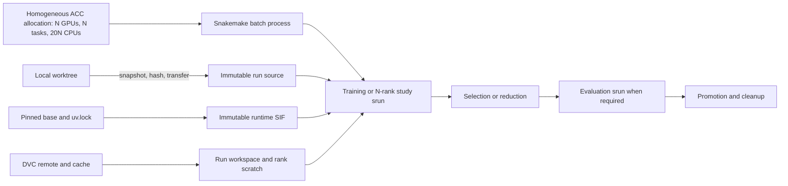

# Relocatable Snakemake, container, and DVC architecture

This workflow separates four independently versioned layers:

1. the scientific runtime SIF;
2. the exact source snapshot from one worktree;
3. content-addressed DVC payloads; and
4. the lightweight host-side dispatch metadata.

The container supplies dependencies, the source bundle supplies behavior, and
DVC supplies data. Several worktrees can therefore run concurrently without a
mutable remote checkout or per-source container rebuild.

## Reusable execution model



The reusable scheduling unit is one homogeneous Slurm allocation on MN5's ACC
partition. Snakemake remains the lightweight batch process inside that
allocation and launches scientific work as Slurm job steps. Rank count is the
concurrency parameter: each scientific rank receives one GPU and 20 CPUs.

A single training run uses one rank. Optuna-managed HPO and ablation studies
use multiple independent ranks. Those ranks coordinate through an Optuna
journal on shared NFS or GPFS rather than MPI, so the pattern is not tied to
distributed model training. Snakemake waits for the aggregate `srun` step and
its per-rank completion markers; `--kill-on-bad-exit=1` makes a rank failure
fail the whole step. Finalization then runs as a later step in the same
allocation, decomposed into declared selection, evaluation, promotion, and
cleanup artifacts.

The same journal-coordinated pattern can span nodes, but the practical default
is a single node. Rank count must therefore normally fit the GPUs available on
one node. The Snakemake batch process has small control-plane CPU overhead and
shares the allocation with the scientific ranks; it does not receive a GPU.

## Runtime image

The SIF contains the slow-moving Linux, Python, native, scientific, DVC, and
Snakemake dependencies. It does not contain project source, the Snakefile,
selected training configs, or data payloads. The runtime dependency key is
independent of ordinary source changes.

Dependency fetching occurs on `wifi-acc`; SIF assembly and GPU validation run
offline in Slurm. Artifacts are published with immutable names, checksums, and
metadata.

## Source bundle

Every run receives a read-only snapshot containing tracked and non-ignored
untracked worktree files. Preparation hashes the copied snapshot, transfers it
through `dt`, verifies its remote inventory and bytes, and then removes write
permission. Later local edits cannot alter an existing run.

Snakemake materializes a content-addressed dependency manifest for each data,
training, evaluation, HPO, ablation, selection, and promotion stage. Every
manifest fingerprints the complete scientific source inventory plus the
stage's relevant configuration fragment. This intentionally gives conservative
invalidation: any scientific source change makes every stage stale, while
documentation and tests remain outside the scientific source contract.
The inventory is exclusion-based: all Python, shell, YAML, TOML, and Snakefile
sources are included unless they live under an explicit non-runtime root such
as `tests/`, `docs/`, or `tex/`. This prevents newly added packages or
root-level modules from silently escaping invalidation.

The source is mounted at `/workspace/source:ro` and placed on `PYTHONPATH`.
This is source injection into the locked runtime, not a package installation or
shared checkout.

## DVC boundary

`.dvc` pointer files belong in the source bundle; their payloads do not.
Preparation enforces that boundary. A staging rule materializes exactly the
configured pointer hashes into a per-run workspace using a shared locked cache.
Each worker copies the small staged inputs to its own node-local directory and
receives them as read-only overlays.

Pointers under `dvc.provenance_targets` contribute their hashes to the run
identity without materializing their payloads. This binds a processed training
dataset to large upstream raw inputs without redundantly copying those inputs
to node-local training scratch.

Only the promotion stage receives write access to the promotion root. Scratch
is disposable; journals, logs, checkpoints, selected artifacts, dependency
contracts, and provenance are durable on GPFS.

## Tooling and MN5 submission policy

Snakemake and DVC are installed from the locked `workflow` dependency group in
the immutable SIF. The remote runner and batch coordinator use that verified
image directly. The coordinator exposes a minimal read-only host integration
contract for MN5's `srun` client, Slurm libraries and configuration, user/group
identity, Munge, and the Snoopy and EAR plugin trees. A nested `srun` step is
therefore launched from the SIF without maintaining a second Python
environment on GPFS.

MN5 derives host memory from CPU count. Submission tooling therefore omits
`--mem` and `--mem-per-cpu` and rejects workflow resources or extra Slurm flags
that introduce explicit host-memory requests. EpiForecaster submits the
containing allocation through its dispatcher and runs Snakemake with the local
executor inside that allocation. Scientific work is launched only as `srun`
job steps within the existing allocation.

Projects that instead have Snakemake submit individual rules to Slurm should
consume the independently versioned
[`lewis-k-s/snakemake-executor-plugin-slurm`](https://github.com/lewis-k-s/snakemake-executor-plugin-slurm)
fork and pin an immutable release in their workflow dependency lock. The fork
provides opt-in validation for CPU-derived-memory sites without coupling the
executor package to EpiForecaster source, data, accounts, partitions, or paths.

## Remote endpoint boundary

Project GPFS is visible through the transfer service, but Slurm state is not
globally visible across every SSH alias. `dt` is attached to the
`bsc_transfer` Slurm controller; its `squeue`, `sacct`, and `scontrol show job`
results cover transfer-cluster jobs only. MN5 compute jobs are owned by the
`marenostrum5` controller reached through compute login aliases such as `mn5`,
`wifi`, and `wifi-acc`.

This creates an important operational split:

| Operation | Endpoint |
| --- | --- |
| Transfer source/data; inspect GPFS logs and artifacts | `dt` |
| Submit, query, account, or cancel GPP compute work | `mn5` or `wifi` |
| Fetch network dependencies and submit/query ACC work | `wifi-acc` |

An empty `squeue`, empty `sacct`, or `Invalid job id` on `dt` must never be
interpreted as evidence that an MN5 compute job is gone. Check the scheduler on
an MN5 compute login and use GPFS markers/logs as separate filesystem evidence.
The active controller can be identified with:

```bash
scontrol show config | grep -E '^ClusterName|^SlurmctldHost'
```

## EpiForecaster workflow shapes

All EpiForecaster training workflows use the common MN5 allocation contract:

```text
account=bsc08
partition=acc
nodes=1
cpus_per_task=20
qos in {acc_bscls, acc_debug}
```

The rank and GPU counts depend on the scientific workflow:

| Workflow | Ranks | Slurm tasks | GPUs | CPUs per task |
| --- | ---: | ---: | ---: | ---: |
| Single training | 1 | 1 | 1 | 20 |
| Optuna-managed HPO | configurable N | N | N | 20 |
| Optuna-managed ablation | configurable N | N | N | 20 |

This is intentionally an MN5-only primary interface. The model is too heavy for
representative local execution, so the repository does not maintain a second
local Snakemake binding. `configs/train_epifor_smoke.yaml` is limited to ten
training batches with one worker per data loader and exists only for bounded
configuration/runtime acceptance.

Single training is a first-class public Snakemake target: it stages its DVC
inputs, launches one training rank, and publishes a checkpoint plus
`training_manifest.json`. Evaluation is a separate target with a hash-bearing
evidence manifest; `train_evaluate` composes both stages. HPO and ablation use
the same allocation pattern with multiple ranks plus their Optuna journals.
Single training and HPO trials disable embedded final evaluation; ablations
retain per-trial test metrics for paired analysis.

Increasing concurrency therefore occurs in complete rank units: one Slurm task,
one GPU, and 20 CPUs per additional rank. Ordinary data-loader worker counts
are separate training parameters and are not part of this allocation topology.

Explicit host-memory directives are rejected. Preparation renders an immutable
TSV dispatch record from this config. The snapshot-owned remote runner reads
that record and issues one matching `sbatch`; no configuration values or target
overrides are supplied at submission time. Multi-rank HPO and ablation
launchers issue one `srun` whose task count matches the configured rank count,
with one GPU per task. Selection, evaluation, promotion, cleanup, and ablation
reduction remain dependent Snakemake stages inside that same allocation.

The Snakemake manager is the batch process and has no separately reserved task
or GPU. It remains resident while the scientific step consumes the requested
task resources. Its small CPU overhead is accepted because these workflows are
normally GPU-bound.

These relationships are an allocation contract, not a requirement for a
general topology-validation subsystem. Implementations may validate obvious
inconsistencies before submission, but the architecture does not depend on a
separate topology model.

## Identity and finalization

The run manifest records:

```text
(Git commit,
 source snapshot SHA-256,
 DVC pointer hashes,
 runtime SIF SHA-256,
 coordinator SIF identity and Snakemake version,
 rendered workflow config SHA-256,
 immutable dispatch-request SHA-256,
 workflow kind and public target,
 optional study identity)
```

Stage-scoped dependency manifests live beside the run manifest under
`.state/dependencies/` and are copied into promoted artifact bundles.

Rank scratch identity includes the Slurm job, allocation task, step, and
process rank. Trial checkpoints live in deterministic `trial-NNNNNN`
directories and record their canonical path and SHA-256 in Optuna attributes.
Only after all ranks complete does the DAG resolve `study.best_trial`, validate
and copy that checkpoint, evaluate it, promote the declared artifacts, and
finally delete losing checkpoint directories.

## Rebuild matrix

| Change | New source bundle | New runtime SIF |
| --- | ---: | ---: |
| Python, Snakefile, wrapper, or scientific config | Yes | No |
| DVC pointer changes | Yes | No |
| Scientific dependency lock changes | Yes | Yes |
| Snakemake/DVC workflow dependency changes | Yes | Yes |
| Pinned base or container assembly changes | If bundled | Yes |

## Implementation map

| Responsibility | Implementation |
| --- | --- |
| DAG composition | `workflow/Snakefile`, `workflow/rules/*.smk` |
| Stage dependency selection and command helpers | `workflow/common.py` |
| Single-training template | `workflow/config/mn5_train.yaml` |
| Evaluation-only template | `workflow/config/mn5_evaluate.yaml` |
| HPO template | `workflow/config/mn5.yaml` |
| Ablation template | `workflow/config/mn5_ablation.yaml` |
| Local Snakemake profile | `workflow/profiles/mn5/config.yaml` |
| Snapshot and allocation validation | `scripts/workflow/run_config.py` |
| Local preparation and transfer | `scripts/workflow/mn5_workflow.sh` |
| Immutable publication, submission, status, and recovery | `scripts/workflow/remote_run.sh` |
| SIF-host Slurm coordinator boundary | `scripts/workflow/snakemake_coordinator.sbatch` |
| Configured multi-rank study/cross-validation launch | `scripts/workflow/launch_parallel_workers.sh` |
| Rank execution and marker | `scripts/workflow/run_parallel_worker.sh` |
| Container isolation and scratch | `scripts/workflow/mn5_container_exec.sh` |
| DVC and artifact contract writers | `scripts/workflow/run_support.py` |
| Runtime build | `containers/runtime/` |

Single-training acceptance uses one rank, one task, 20 CPUs, and one GPU.
HPO/ablation smoke tests preserve the multi-rank scheduling shape while reducing
scientific work such as trials, epochs, or batches. The queue contains one
parent job, while `sacct` exposes the batch and scientific `srun` steps inside
it.
